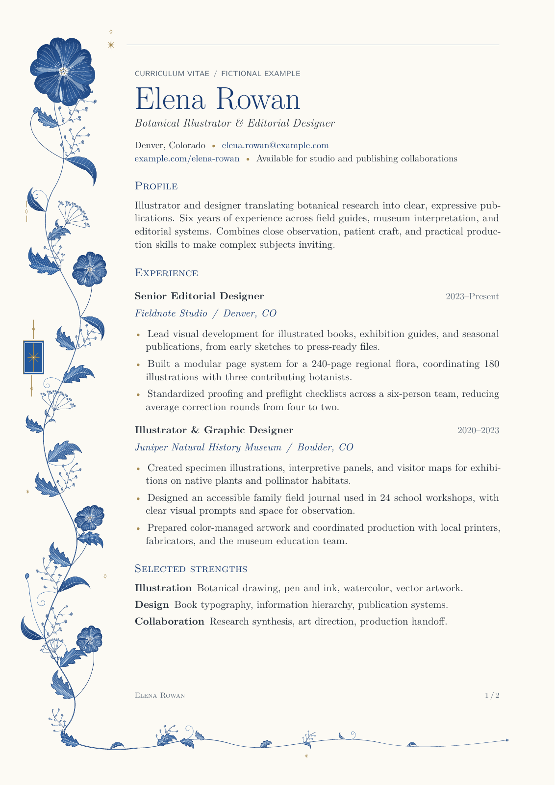
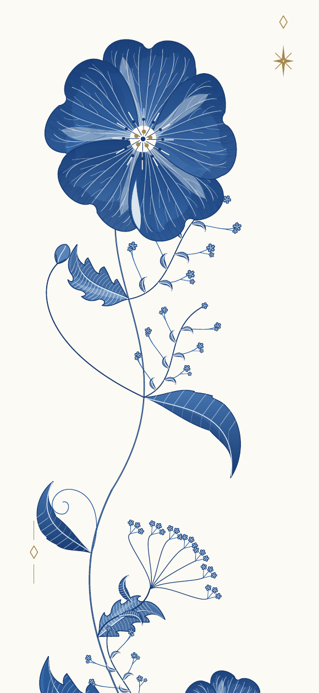
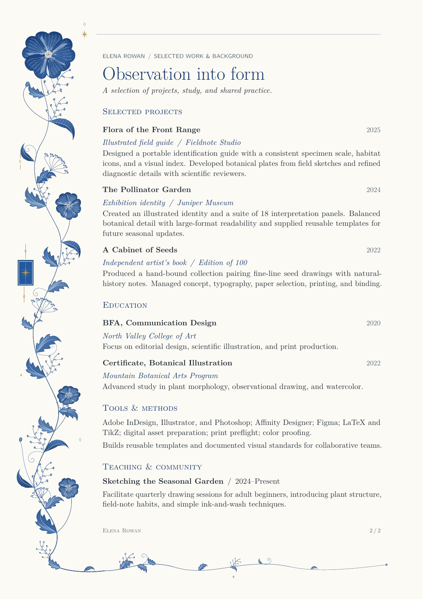

# Folia

**Procedural botanical page borders in pure TikZ.**

Folia draws five-petalled blue flowers, curling leaves, fine meadow sprays, and
restrained gold ornament around a LaTeX document. It explores the manuscript border in
[this r/LaTeX post](https://www.reddit.com/r/LaTeX/comments/1xixznw/how_do_you_make_these_flowers_in_latex/).
The artwork is generated from editable TikZ paths, with a seed controlling the
variation from page to page.

<p align="center">
  <a href="docs/examples/resume.pdf"></a>
</p>

[View the two-page PDF](docs/examples/resume.pdf) ·
[Example source](floral-manuscript/main.tex) ·
[Package guide](floral-manuscript/README.md)

## Build the example

Use **pdfLaTeX** with a current TeX distribution containing PGF/TikZ. The example
also uses Latin Modern, `geometry`, `microtype`, and `hyperref`. No Lua code,
external artwork, Python, network access, or shell escape is needed to build it.

```sh
git clone https://github.com/pgerhardt/folia.git
cd folia
sh floral-manuscript/build.sh
```

Open `floral-manuscript/sample-resume.pdf`. The script runs pdfLaTeX twice so
TikZ's remembered page coordinates settle. The names, biography, and achievements
in the sample résumé are fictional.

To compile manually, run these commands from `floral-manuscript/`:

```sh
pdflatex -no-shell-escape main.tex
pdflatex -no-shell-escape main.tex
```

## Use in your document

Copy `floralmanuscript.sty` beside your `.tex` file, reserve room for the border,
and load the package:

```tex
\documentclass[11pt,a4paper]{article}
\usepackage[left=51mm,right=21mm,top=25mm,bottom=33mm]{geometry}
\usepackage{floralmanuscript}
\FloralSetup{seed=314159,paper=true}

\begin{document}
\section*{A page in bloom}
Your document supplies the text and typography; the package draws the border.
\end{document}
```

The package does not change fonts, margins, page numbering, or page style.

## Drawing and composition

A large five-petalled flower anchors the upper left. Seven connected S-curves
carry the border through alternating lobed and narrow, drooping leaves,
smaller blossoms, compound umbels, buds, and fine meadow sprays. The growth turns
around the lower-left corner into a progressively lighter horizontal trail.
Branches attach to points on the actual stem curves.

Clipped translucent washes, darker pools, radial veins, and fine hatching give
the blue plants depth. Muted gold is reserved for small diamonds, a few stars,
and one framed star ornament. Everything remains vector artwork in the PDF.



## Controlled variation

The major stem paths, focal flowers, and gold accents are deliberately placed.
The seed and physical page count vary leaf angles, proportions and tones, petal
shapes and wash details, and the reach of fine sprays within that composition.
A fixed seed and page sequence reproduce the same drawing. The variation uses
a private arithmetic function and does not consume PGF's random-number stream.
Resetting printed page numbers does not reset the physical page counter.



## Controls

| Setting | Effect |
| --- | --- |
| `\FloralSetup{seed=271828}` | Vary botanical details; use a positive integer from 1 to 1,000,000 |
| `\FloralSetup{paper=false}` | Omit the ivory background |
| `\FloralOff` | Disable the border and background |
| `\FloralOn` | Enable the border again |

Redefine `FloralInk`, `FloralBlue`, `FloralPale`, `FloralGold`, and `FloralPaper`
to change colors. See the [package guide](floral-manuscript/README.md) for an
example and instructions for changing settings between pages.

## Layout limits

This is a border for reserved margins. It uses the paper dimensions, but does not
measure the text or fill empty regions below a paragraph. Keep body text to the
right of 44 mm from the left edge and above 30 mm from the bottom edge. The A4
example's 51/21/25/33 mm margins provide clearance. Check custom headers, footers,
and page sizes in the rendered PDF.

Borders stay on the left rather than mirroring to the outer edge of a two-sided
document. The vertical composition scales with page height; it is tuned for A4
and is not an automatic layout system. Small gold stars are decorative.

## Source

The package is contained in [one `.sty` file](floral-manuscript/floralmanuscript.sty).
The [example](floral-manuscript/main.tex) supplies the résumé content and layout;
[build.sh](floral-manuscript/build.sh) supplies the two-pass pdfLaTeX build.

MIT licensed. See [LICENSE](LICENSE).
